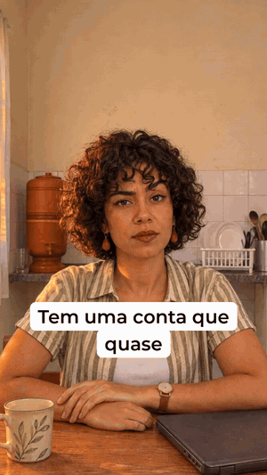
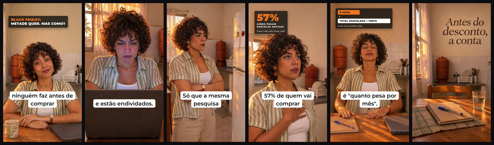
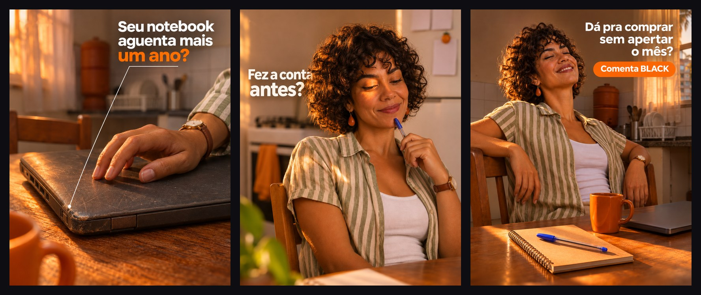
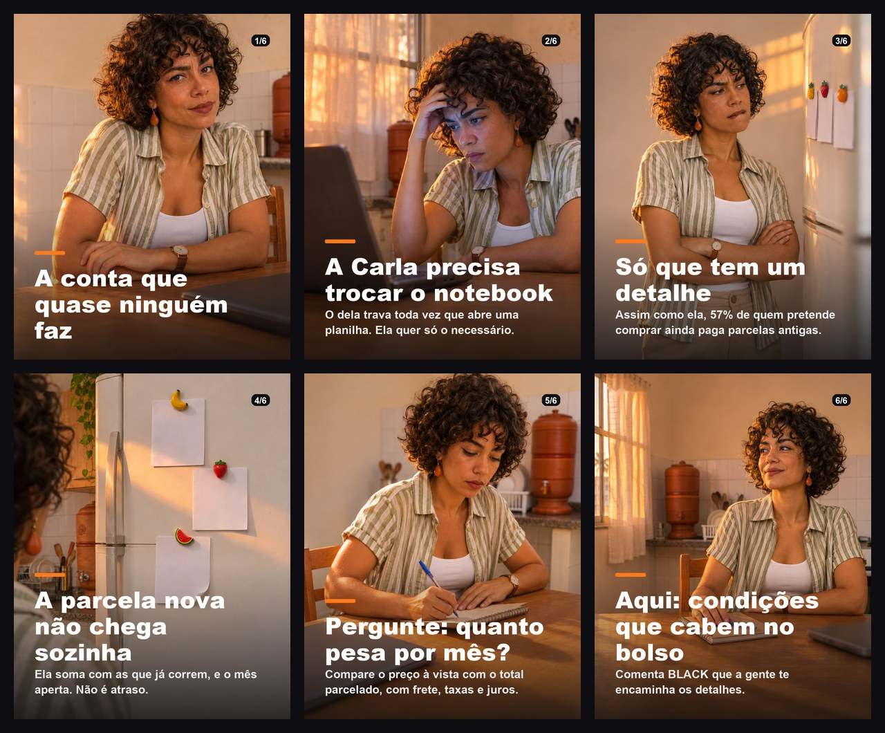
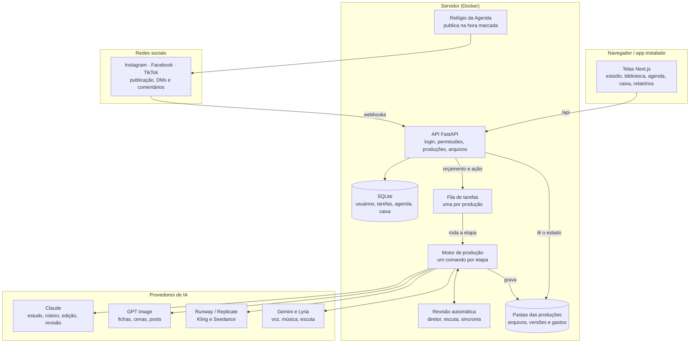

<h1 align="center">MFlow Filme</h1>

  <b>Vídeos, posts e carrosséis feitos com IA, do roteiro à publicação, sem fotógrafo e sem videomaker.</b> 
  Das fotos simples de um produto (ou de um tema de pauta) ao Reels editado, aos posts do Instagram, à agenda de
  publicação e ao atendimento de quem comenta.

  
  
  
  
  
  
  
  
  
   
  
  
  
  
  
  

---

## Um resultado real

**Black Friday 2026 · Notícia** é uma pauta feita do zero no sistema, sem nenhuma foto de partida: só o tema. A IA
pesquisou o assunto, escreveu o roteiro em tom de notícia, criou a personagem e o cenário, gerou as cenas, deu
movimento a elas, gravou a narração, compôs a trilha, editou com gráficos de dados e montou o filme com legenda.
Do mesmo roteiro saíram os 3 posts da semana e um carrossel de 6 telas, cada peça com a sua legenda.

<table>
  <tr>
    <td width="34%" valign="top">
       
      <b>Reels de 45 s (9:16).</b> Os primeiros segundos, em GIF. 
      <a href="assets/exemplo-filme.mp4">▶ Assistir ao filme completo, com som (MP4)</a>
    </td>
    <td valign="top">
      <b>O que a IA fez nesta produção</b>
      <ul>
        <li><b>Pesquisa:</b> números da CNDL/SPC Brasil e orientações do Procon, citados na tela com a fonte.</li>
        <li><b>Roteiro em história:</b> a Carla precisa trocar o notebook, mas descobre que a parcela nova soma com
          as que já correm. A pergunta deixa de ser "quanto custa" e vira "quanto pesa por mês".</li>
        <li><b>Elenco criado pela IA:</b> a mesma pessoa, com o mesmo rosto e a mesma roupa, em todas as cenas, nos
          posts e no carrossel.</li>
        <li><b>Edição:</b> gráficos animados com os dados da pesquisa, legenda no estilo Instagram e cartela final.</li>
        <li><b>Instagram:</b> 3 posts com papéis diferentes (dia 1, 2 e 5 da semana) e um carrossel que conta a
          mesma história, com a palavra-chave <b>BLACK</b> para a automação responder no privado.</li>
      </ul>
    </td>
  </tr>
</table>

**Os 3 posts da semana** (4:5, 1080 × 1350), cada um com a sua legenda e o seu dia na agenda:

**O carrossel de 6 telas**, que conta a história inteira e termina chamando para comentar:

Exemplo de demonstração: a marca da loja original foi retirada das peças e das legendas.

---

## O problema

Vender em marketplace e nas redes exige imagem o tempo todo: foto do produto em uso, vídeo curto para o anúncio
do Mercado Livre e da Shopee, Reels, TikTok, posts e carrossel no Instagram, e alguém para publicar e responder.
Para a maioria das empresas isso esbarra em quatro limites:

- **Custo de produção.** Fotógrafo, modelo, locação, videomaker, locutor e editor para cada produto. Em um catálogo
  com dezenas ou centenas de itens, a conta não fecha, e só os carros-chefe ganham conteúdo.
- **Tempo.** Cada vídeo depende de agenda, gravação e edição. Quando o produto chega, o conteúdo demora a sair.
- **Qualidade irregular.** Ferramentas de IA soltas geram rápido, mas erram o produto (forma, cor, peças, tamanho),
  escrevem letras erradas na imagem e não seguem um roteiro. O gasto com tentativas fica invisível.
- **Ferramentas espalhadas.** Um sistema para criar, outro para agendar, outro para responder comentários e DMs, e
  nenhum para dizer o que deu resultado.

## A solução

O MFlow Filme junta a cadeia inteira num só sistema:

1. **Cria** o conteúdo: a partir das fotos reais de um produto, tiradas no celular, ou de uma pauta (um tema, uma
   notícia, uma ideia de campanha), o sistema estuda, escreve o roteiro, cria o elenco, gera cada cena, dá
   movimento, grava a narração, compõe a música, edita e monta o filme, e faz os posts e o carrossel.
2. **Guarda** tudo pronto na **Biblioteca**, com as legendas de cada peça.
3. **Publica** pela **Agenda** no Instagram, no Facebook e no TikTok, com aprovação antes de ir ao ar.
4. **Atende** quem comenta e manda mensagem, numa **Caixa de entrada** única, com **automações** por palavra-chave e
   um **chatbot** que conhece os produtos.
5. **Mede** em **Relatórios**: o que performou, o crescimento das contas, o tempo de atendimento e o gasto com IA.

A pessoa da empresa age como **diretora de criação**: em cada etapa ela vê o resultado, aprova ou pede um ajuste em
palavras ("na cena 3 quero o produto em cima da mesa"). Nenhuma geração paga roda sem confirmação, e todo gasto fica
registrado.

## Funcionalidades

### Uma produção guiada em 12 etapas

Dois pontos de partida: **produto com fotos** (as fotos reais e a ficha do fornecedor) ou **conteúdo do zero** (a
pauta: o sistema pesquisa o tema e planeja a semana de posts). Depois, o caminho é o mesmo.

```mermaid
flowchart LR
    A[Fotos do produto<br>ou pauta] --> B[Estudo]
    B --> C[Elenco]
    C --> D[Roteiro]
    D --> E[Imagens<br>de referência]
    E --> F[Cenas<br>uma foto por cena]
    F --> G[Vídeos<br>a foto ganha movimento]
    G --> H[Som<br>voz, música e efeitos]
    H --> I[Edição]
    I --> J[Filme]
    J --> K[Instagram<br>3 posts e 1 carrossel]
    K --> L[Agendar]
```

| Etapa | O que acontece |
|---|---|
| **Fotos ou Pauta** | Até 20 fotos reais do produto com as **medidas confirmadas**, ou o tema da pauta, com links e o objetivo do vídeo. |
| **Estudo** | Do produto: o que é, para quem vender, onde a IA de imagem costuma errar e 3 ideias de filme. Do tema: a pesquisa em artigos e notícias, o que dizer, para quem e os 5 dias de postagem. |
| **Elenco** | Pessoa criada pela IA ou pessoa real com autorização registrada. Cada pessoa vira uma ficha que mantém o mesmo rosto em todas as cenas. |
| **Roteiro** | Cenas, narração, voz, velocidade e música, com **prévia da voz** para ouvir antes de aprovar. |
| **Imagens** | Fichas de referência do produto em várias vistas, das pessoas e dos lugares. Elas travam a aparência. |
| **Cenas** | Uma foto por cena, que vira o primeiro quadro do vídeo. O que se aprova aqui é o que sai no filme. |
| **Vídeos** | Cada foto aprovada ganha movimento, começando por uma **cena de teste**. Várias tomadas por cena. |
| **Som** | Narração fala por fala, música composta para o filme e efeitos sonoros nos momentos certos. |
| **Edição** | A IA assiste ao material e propõe pausas, zoom, flash e **gráficos com os dados** do estudo. Cada decisão liga e desliga. |
| **Filme** | Montagem final com legenda, música e narração, e uma **conferência automática de sincronia**. |
| **Instagram** | 3 posts e um carrossel de 6 telas com o mesmo elenco e cenário do filme, e a legenda de cada peça. |
| **Agendar** | A semana de posts da produção vai para a Agenda sem sair da tela. |

Com a **sequência automática**, o "Próximo" da primeira etapa faz o estudo, o elenco e o roteiro sozinho, e aprovar o
roteiro faz as imagens, as cenas e a narração. A pessoa só aprova.

### 9 tons de vídeo

Cada produção escolhe um tom, que manda no ritmo, na imagem, na narração, na música, nos efeitos e na legenda.
Todo tom tem a sua receita para os **3 primeiros segundos**, que o roteiro segue e a revisão automática confere.

| Tom | Para quê |
|---|---|
| **Comercial** | Comercial de TV: voz clara de apresentador, demonstração do produto, antes e depois. |
| **Trailer de curta** | Linguagem de cinema: contraluz, tensão, voz grave e pausada. |
| **Viral TikTok** | Gancho no primeiro segundo, cortes muito rápidos, fala acelerada. |
| **Achadinhos** | Produto em destaque, fala animada e cortes rápidos. |
| **Vlog** | Gravado "pela própria pessoa" no celular, com fala em cena no ritmo da boca. |
| **Clip de marketplace** | Objetivo, para Mercado Livre e Shopee: o produto na tela em pelo menos metade do vídeo. |
| **Review** | Opinião de criador de conteúdo, com veredito baseado só no que o estudo confirmou. |
| **Unboxing** | A caixa chega e é aberta em cortes: revelação, detalhe e primeira reação. |
| **Notícia** | Informativo e feito para prender até o fim: dado, fonte na tela e uma história que explica (o tom do exemplo acima). |

### Formatos para cada canal

- **Vídeo em pé (9:16)** para Reels, TikTok, Shorts e clips de marketplace, ou **deitado (16:9)** para YouTube e site.
- **Resolução** de 720p ou 1080p, com a duração escolhida na criação.
- **Posts e carrossel em 4:5** (1080 × 1350): fotos novas pensadas para o feed, e não quadros recortados do vídeo.
- **Identidade visual por marca:** cada produção escolhe a marca, que define o selo discreto e as cores dos títulos,
  dos rótulos e dos gráficos.

### Aprovação por etapa e custo sob controle

- **Nada é gasto sem confirmação.** Toda geração paga mostra antes o **valor estimado** e o **tempo previsto**,
  aprendido com as tarefas já feitas.
- **O valor mostrado é o do que vai rodar.** A estimativa sai do mesmo comando que executa a geração.
- **Todo gasto fica registrado** por etapa, com quem pediu, separado entre filme e Instagram.
- **Erro barato primeiro.** Cada cena vira foto antes de virar vídeo, e os vídeos começam por uma cena de teste.

### Revisão automática antes de você ver

- **Diretor de imagem.** A IA confere cada foto de cena, cada vídeo e cada peça do Instagram contra o roteiro e a
  ficha do produto, e refaz sozinha o que reprova (produto deformado, virado, deslizando), até 3 tentativas.
- **Escuta do áudio.** Cada vídeo gerado é ouvido: música indevida sai, e no tom Vlog a escuta acha o segundo exato
  em que a pessoa fala.
- **Conferência de sincronia.** Depois de montar, procura fala fora da cena, trecho sem voz e legenda fora da voz.
- **Elenco seguro.** Fotos de pessoa real passam por uma conferência que barra menores de idade e pessoas famosas.

### Som, edição e legenda

- Narração com **30 vozes**, velocidade ajustável e regravação só das falas que mudaram.
- Música composta para cada filme, em **14 gêneros**.
- Efeitos sonoros marcados pela IA nos momentos certos, que podem ser desligados um a um.
- **10 opções de legenda**: TikTok, karaokê, uma palavra por vez, Instagram, achadinhos, vlog, TV, TV com tarja,
  discreta ou sem legenda.
- **Novo corte** (as mesmas cenas em outro tom, sem gerar imagem nem vídeo de novo) e **nova versão** (outra ideia
  do estudo, reaproveitando fotos e medidas).

### Biblioteca

Tudo o que ficou pronto, por produto: o filme, os posts e o carrossel, com as legendas para copiar, o download de
cada peça (ou do carrossel inteiro em ZIP) e o botão **Agendar**. Dá para enviar também vídeos e fotos feitos fora
do sistema.

### Agenda

- **Calendário** com os posts marcados no **Instagram**, no **Facebook** e no **TikTok**, publicados pelas APIs
  oficiais de cada rede na hora marcada.
- **A semana pronta:** um produto da Biblioteca vira um post por dia (o filme, os posts e o carrossel), com as
  contas da marca já marcadas.
- **Grade de horários** com 9 posts por dia em cada marca, misturando Reels, posts e carrosséis nos horários de
  mais alcance.
- **Aprovação:** quem cria manda para aprovação, e o responsável aprova um por um ou todos de uma vez.

### Caixa de entrada, automação e chatbot

- **Caixa de entrada única** com as DMs e os comentários do Instagram e do Facebook, com filtros por marca e conta.
- **Automações:** um comentário ou uma DM com a palavra-chave (como o **BLACK** do exemplo) recebe a resposta no
  comentário e a mensagem no privado. O carrossel de cada produção já nasce com a sua automação sugerida.
- **Chatbot** que responde DMs e comentários com o que a empresa escreveu (frete, prazos, pagamento, garantia) e com
  o estudo dos produtos da Biblioteca. O que ele não sabe, passa para a equipe.

### Relatórios

Posts (alcance, interações e quais formatos e horários rendem mais), contas (seguidores e alcance dia a dia),
atendimento (tempo até a primeira resposta e quem respondeu) e produção (gasto com IA por mês, em reais pela cotação
do dia do gasto). Tudo na tela e em **PDF**.

### Equipe e permissões

- **Permissões por pessoa e por módulo:** ver, criar, editar e excluir em cada um dos **10 módulos** (Biblioteca,
  Produções, Agenda, Aprovação, Automação, Caixa, Chatbot, Contas conectadas, Pessoas e Relatórios). Os botões somem
  para quem não pode usá-los, e a API recusa do mesmo jeito.
- Várias pessoas na mesma produção, com a tela atualizada sozinha.
- Tarefas rodam no servidor: dá para fechar a página, e cada item pronto já aparece.
- Instalável como aplicativo no celular.

## Arquitetura

- **Telas (Next.js).** A produção é um estúdio: etapas à esquerda, a etapa aberta no centro, o monitor com a prévia à
  direita e a linha do tempo das cenas embaixo. O resto do sistema usa um menu lateral por módulos.
- **API (FastAPI).** Login, permissões, produções, arquivos, agenda, caixa e relatórios. Cada botão vira os
  argumentos de um comando do motor, os mesmos para o orçamento e para a execução.
- **Fila de tarefas.** Roda as etapas em segundo plano, uma por produção, com produções diferentes em paralelo.
- **Motor de produção.** Um comando por etapa, que também funciona pelo terminal. Chama as IAs, controla a geração
  em paralelo e registra cada gasto.
- **Redes sociais.** Publicação, DMs e comentários pelas APIs oficiais da Meta e do TikTok; os webhooks alimentam a
  Caixa de entrada, as automações e o chatbot.
- **Armazenamento.** Cada produção é uma pasta com arquivos e JSON: dá para abrir, copiar e fazer backup sem o
  sistema. O SQLite guarda usuários, tarefas, agenda, conversas e relatórios.

## Decisões técnicas

1. **Foto primeiro, vídeo depois.** Toda cena nasce como foto aprovada e só então ganha movimento, começando por uma
   cena de teste. O erro é corrigido onde é barato.
2. **Revisão automática com limite.** Erros grosseiros da IA são barrados antes de chegar à tela, com no máximo 3
   tentativas por item. A partir daí a decisão volta para a pessoa, e o gasto não dispara.
3. **Orçamento e execução no mesmo comando.** O valor da confirmação é calculado pelo próprio comando que vai rodar.
4. **Uma tarefa por produção, com trava no estado.** Impede duas tarefas na mesma produção, mesmo vindas de outra
   aba ou de outra pessoa.
5. **Integrações feitas em casa, só com APIs oficiais.** Agenda, automação e caixa de entrada foram escritas no
   próprio sistema, sem depender de ferramentas de terceiros nem de licenças que obrigariam a abrir o código.
6. **Modelo certo para cada tarefa.** O modelo mais forte escreve e revisa; o chatbot usa um modelo barato, porque
   responde muito e cada resposta precisa custar uma fração de centavo.
7. **Modo simulado de ponta a ponta.** Uma chave de ambiente troca todas as IAs por imagens, vídeos e sons falsos, e
   o fluxo inteiro pode ser testado sem gastar.

## Tecnologias

| Camada | Tecnologias |
|---|---|
| Interface | Next.js 16, React 19, TypeScript, Tailwind CSS 4, Radix UI, aplicativo instalável (manifest e service worker) |
| API | Python 3.12, FastAPI, Uvicorn, fila de tarefas própria, SQLite em modo WAL, e-mail por SMTP |
| Motor | Python, Pillow, NumPy, MediaPipe (a boca na fala em cena), ffmpeg, Chromium sem tela (gráficos da edição) |
| Texto e revisão | Claude (estudo, roteiro, edição, Instagram e revisão), GPT (chatbot e reserva) |
| Imagem | GPT Image (geração e edição) |
| Vídeo | Kling 4 e Seedance pela Runway, e Kling 4 pelo Replicate como reserva |
| Áudio | Gemini TTS (narração), Lyria (música), efeitos sonoros pela Runway, Gemini (escuta e transcrição) |
| Redes sociais | Instagram Graph API, Facebook Pages API, TikTok Content Posting API, webhooks da Meta |
| Infraestrutura | Docker, proxy reverso com HTTPS, servidor VPS |

## Qualidade e segurança

- **Senhas** com hash scrypt e sal, regras de senha forte e links de convite e de troca guardados como hash.
- **Login com freio** depois de várias tentativas, e login com Google opcional, que só aceita quem já foi cadastrado.
- **Cookie de sessão assinado**, com HTTPS obrigatório em produção. A API não expõe porta: só o proxy alcança.
- **Permissões conferidas na API**, e não só escondidas na tela.
- **Direito de imagem:** pessoa real no elenco só adulta, com autorização registrada e conferência das fotos.
- **Chaves das IAs e das redes** ficam apenas no ambiente do servidor, nunca no repositório.
- **Páginas de privacidade e de exclusão de dados**, exigidas pela Meta para o app das redes.
- **Verificação:** checagem de tipos das telas (TypeScript) e o modo simulado, que percorre todas as etapas sem
  custo. Ainda não há suíte de testes automatizados.

**Em números** (contados no código-fonte): 12 etapas, 9 tons de vídeo, 10 opções de legenda, 30 vozes de narração,
14 gêneros musicais, 10 módulos com permissão própria, 27 comandos no motor de produção e 119 rotas na API.

## Status

**Em uso diário** por uma empresa, rodando em servidor próprio com Docker e HTTPS. Em evolução contínua.

---

  Projeto desenvolvido por <b>Matheus Silva · MFlow</b> 
  <a href="https://mflowstudio.com.br">mflowstudio.com.br</a> ·
  <a href="https://github.com/portfolio-mflow">github.com/portfolio-mflow</a>

O código-fonte é privado. Demonstração disponível mediante contato.

